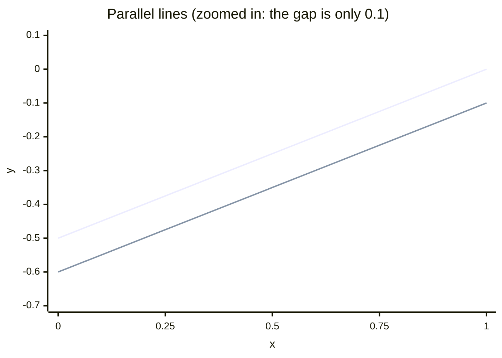

# Addition method

## Problem

Solve by addition:

$$
\begin{cases}
-x + 2y = -1 \\
5x - 10y = 6
\end{cases}
$$

## My attempt

**Multiply the first equation by 5:**

$$
\begin{aligned}
5(-x + 2y) &= 5(-1) \\[6pt]
-5x + 10y &= -5
\end{aligned}
$$

**Add the equations:**

$$
\begin{aligned}
-5x + 10y &= -5 \\
5x - 10y &= 6 \\
\hline
0x + 0y &= 1 \\
0 &= 1
\end{aligned}
$$

**Conclusion.** Both variables cancel and the result is a false statement, so the system is
**inconsistent: no solution**.

**Why, geometrically.** Rewrite each equation in slope-intercept form $y = mx + b$:

$$
\begin{aligned}
-x + 2y &= -1 &\qquad 5x - 10y &= 6 \\
2y &= x - 1 & -10y &= -5x + 6 \\
y &= \tfrac{1}{2}x - \tfrac{1}{2} & y &= \tfrac{1}{2}x - \tfrac{3}{5}
\end{aligned}
$$

| Line | Slope $m$ | Intercept $b$ |
|---|---|---|
| $-x + 2y = -1$ | $\tfrac{1}{2}$ | $-\tfrac{1}{2} = -0.5$ |
| $5x - 10y = 6$ | $\tfrac{1}{2}$ | $-\tfrac{3}{5} = -0.6$ |

Same slope, different intercepts: the lines are **parallel**, always $0.1$ apart vertically,
so they never meet.

Upper line: $y = \tfrac{1}{2}x - 0.5$. Lower line: $y = \tfrac{1}{2}x - 0.6$.

## Mistake / lesson

## Related

- [Systems of linear equations](../../../notes/algebra/linear-systems/two-variables.md)
