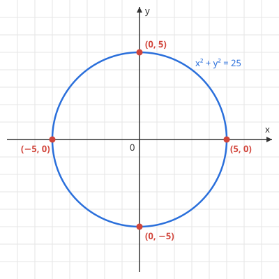
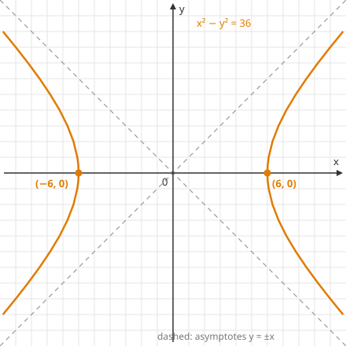
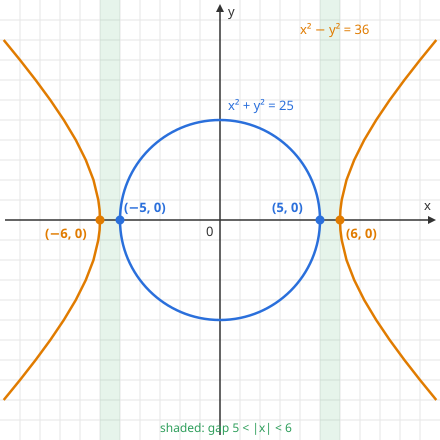

# Any method

## Problem

Solve the system using any method.

$$
\begin{cases}
x^2 + y^2 = 25 \\
x^2 - y^2 = 36
\end{cases}
$$

## My attempt

**Label the equations.**

$$
\begin{aligned}
x^2 + y^2 &= 25 && (1) \\
x^2 - y^2 &= 36 && (2)
\end{aligned}
$$

**Identify (1).**

- $x$ appears only as $x^2$, so $x$ and $-x$ give the same result: the curve is mirrored
  across the $y$-axis.
- $y$ appears only as $y^2$, so the curve is also mirrored across the $x$-axis.
- Both squares have coefficient $1$, so both directions stretch by the same amount: the
  curve is a **circle** centered at the origin.

**Radius.** With $y = 0$ (on the $x$-axis):

$$
x^2 = 25 \ \Rightarrow \ x = \pm\sqrt{25} = \pm 5
$$

So the radius is $5$, and the circle crosses the axes at $(5, 0)$, $(-5, 0)$, $(0, 5)$ and
$(0, -5)$.

**Identify (2).**

- $x$ and $y$ still appear only squared, so the curve is mirrored across both axes.
- The coefficients are **not** equal ($+1$ and $-1$), so it is not a circle: it is a
  **hyperbola**, made of two separate branches (each one looks like a parabola).

**Vertices.** With $y = 0$:

$$
x^2 = 36 \ \Rightarrow \ x = \pm 6
$$

The vertices are $(6, 0)$ and $(-6, 0)$. Since $x^2 = 36 + y^2 \ge 36$, there are no points
between them: $x \le -6$ or $x \ge 6$. As $|y|$ grows, $|x|$ grows too, so the branches open
away from the origin.

**Both curves together.** The circle only exists for $-5 \le x \le 5$ and the hyperbola only
for $|x| \ge 6$, so they have **no points in common**. (If (1) were $x^2 + y^2 = 36$, the
circle would touch the hyperbola at its two vertices: two solutions.)

**Confirm with the algebra.**

**Step 1: (1) + (2)** (the $y^2$ terms cancel)

$$
\begin{aligned}
x^2 + y^2 &= 25 \\
x^2 - y^2 &= 36 \\
\hline
2x^2 &= 61 \\[6pt]
x^2 &= \frac{61}{2}
\end{aligned}
$$

**Step 2: substitute $x^2 = \frac{61}{2}$ into (1).**

$$
\begin{aligned}
\frac{61}{2} + y^2 &= 25 \\[6pt]
y^2 &= \frac{50 - 61}{2} = -\frac{11}{2}
\end{aligned}
$$

No real number squared is negative, so there is no real $y$. A real $x$ alone
($x = \pm\frac{\sqrt{122}}{2}$) is not enough: a solution needs both coordinates.

**Answer.** No real solution, as the graph showed.

## Mistake / lesson

## Related

- [Systems of nonlinear equations and inequalities](../../../notes/algebra/nonlinear-systems/two-variables.md)
