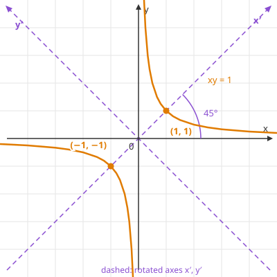
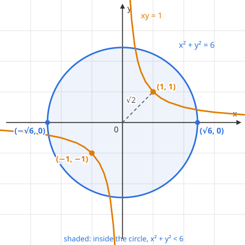

# Any method

## Problem

Solve the system using any method.

$$
\begin{cases}
x^2 + y^2 = 6 \\
xy = 1
\end{cases}
$$

## My attempt

**Label the equations.**

$$
\begin{aligned}
x^2 + y^2 &= 6 && (1) \\
xy &= 1 && (2)
\end{aligned}
$$

**Identify (1).** Both squares have coefficient $1$, so it is a circle centered at the origin
with radius $\sqrt{6}$. It crosses the axes at $(\sqrt{6}, 0)$, $(-\sqrt{6}, 0)$,
$(0, \sqrt{6})$ and $(0, -\sqrt{6})$.

**Identify (2).** This one is a hyperbola, but the test from #30 (squares with opposite signs)
does not apply as written: (2) has no $x^2$ or $y^2$ at all, only the cross term $xy$. The idea
is to look at the same curve from a different angle: rotate the coordinate axes so that the
cross term disappears and the squares show up.

**Quick test: the discriminant.** Every conic can be written in the general form

$$
Ax^2 + Bxy + Cy^2 + Dx + Ey + F = 0
$$

and the sign of $B^2 - 4AC$ tells the type of curve without rotating anything (rotation
changes $A$, $B$ and $C$, but not $B^2 - 4AC$):

| $B^2 - 4AC$ | Curve |
|---|---|
| $< 0$ | ellipse (a circle when $B = 0$ and $A = C$) |
| $= 0$ | parabola |
| $> 0$ | hyperbola |

Applied to the system:

| Eq. | General form | $A$ | $B$ | $C$ | $B^2 - 4AC$ | Curve |
|---|---|---|---|---|---|---|
| (1) | $x^2 + y^2 - 6 = 0$ | $1$ | $0$ | $1$ | $0 - 4 = -4 < 0$ | ellipse; $B = 0$, $A = C$: circle |
| (2) | $xy - 1 = 0$ | $0$ | $1$ | $0$ | $1 - 0 = 1 > 0$ | hyperbola |

The test says *what* (2) is; the rotation below shows *why*. The rotation angle $\theta$ that
removes the $xy$ term comes from

$$
\cot 2\theta = \frac{A - C}{B} = \frac{0 - 0}{1} = 0 \ \Rightarrow \ 2\theta = 90° \ \Rightarrow \ \theta = 45°
$$

**Why 45°.** Swapping $x$ and $y$ in $xy = 1$ gives the same equation, so the curve is mirrored
across the line $y = x$. That line, at $45°$ from the $x$-axis, is the natural axis of the
curve. So we rotate the axes $45°$ counterclockwise and call the new coordinates $(x', y')$.

**Rotation of axes.** Take a point $P$ at distance $r$ from the origin, making an angle $\varphi$
with the $x$-axis:

$$
x = r\cos\varphi, \qquad y = r\sin\varphi
$$

After rotating the axes by $\theta$, the same point makes the angle $\varphi - \theta$ with the
new $x'$-axis (the point did not move, the axes did):

$$
x' = r\cos(\varphi - \theta), \qquad y' = r\sin(\varphi - \theta)
$$

To shorten the writing, call the new angle $\alpha = \varphi - \theta$. Then

$$
x' = r\cos\alpha, \qquad y' = r\sin\alpha, \qquad \varphi = \alpha + \theta
$$

To go back to $x$ and $y$ we need the cosine and sine of a **sum** of two angles. These are
the angle-sum identities (from trigonometry):

$$
\begin{aligned}
\cos(\alpha + \theta) &= \cos\alpha\cos\theta - \sin\alpha\sin\theta \\
\sin(\alpha + \theta) &= \sin\alpha\cos\theta + \cos\alpha\sin\theta
\end{aligned}
$$

The minus sign comes from the cosine identity itself: $\cos(\alpha + \theta)$ is **not**
$\cos\alpha + \cos\theta$. (Quick check with $\alpha = \theta = 45°$:
$\cos 90° = 0$, and $\frac{\sqrt{2}}{2}\cdot\frac{\sqrt{2}}{2} - \frac{\sqrt{2}}{2}\cdot\frac{\sqrt{2}}{2} = 0$
$\checkmark$.)

Now apply them, multiplying by $r$:

$$
\begin{aligned}
x = r\cos\varphi &= r\cos(\alpha + \theta) \\
&= r\,(\cos\alpha\cos\theta - \sin\alpha\sin\theta) \\
&= (r\cos\alpha)\cos\theta - (r\sin\alpha)\sin\theta \\
&= x'\cos\theta - y'\sin\theta \\[10pt]
y = r\sin\varphi &= r\sin(\alpha + \theta) \\
&= r\,(\sin\alpha\cos\theta + \cos\alpha\sin\theta) \\
&= (r\sin\alpha)\cos\theta + (r\cos\alpha)\sin\theta \\
&= y'\cos\theta + x'\sin\theta
\end{aligned}
$$

So the rotation formulas are:

$$
x = x'\cos\theta - y'\sin\theta, \qquad y = x'\sin\theta + y'\cos\theta
$$

With $\theta = 45°$, $\cos 45° = \sin 45° = \frac{\sqrt{2}}{2}$:

$$
\begin{aligned}
x &= \tfrac{\sqrt{2}}{2}(x' - y') && (3) \\
y &= \tfrac{\sqrt{2}}{2}(x' + y') && (4)
\end{aligned}
$$

**Substitute (3) and (4) into (2).**

$$
\begin{aligned}
\tfrac{\sqrt{2}}{2}(x' - y') \cdot \tfrac{\sqrt{2}}{2}(x' + y') &= 1 \\[6pt]
\tfrac{2}{4}\,(x'^2 - y'^2) &= 1 \\[6pt]
x'^2 - y'^2 &= 2 && (5)
\end{aligned}
$$

Now the squares have opposite signs ($+1$ and $-1$): in the $(x', y')$ axes, (2) is a
hyperbola just like the one in #30, opening along the $x'$-axis.

**Vertices.** With $y' = 0$ in (5): $x'^2 = 2$, so $x' = \pm\sqrt{2}$. Back in $(x, y)$ with
(3) and (4):

$$
x' = \sqrt{2},\ y' = 0 \ \Rightarrow \ x = \tfrac{\sqrt{2}}{2}\cdot\sqrt{2} = 1,\ \
y = \tfrac{\sqrt{2}}{2}\cdot\sqrt{2} = 1
$$

The vertices are $(1, 1)$ and $(-1, -1)$, on the line $y = x$. Check: $1 \cdot 1 = 1$
$\checkmark$.

**Both curves together.** Test whether the vertex $(1, 1)$ is inside the circle
($x^2 + y^2 < 6$):

$$
1^2 + 1^2 = 2 < 6 \ \checkmark
$$

So the vertex is at distance $\sqrt{2}$ from the origin, less than the radius $\sqrt{6}$: it is
**inside** the circle. By symmetry, $(-1, -1)$ is inside too. Each branch starts inside the
circle and goes off to infinity in both directions, so it must cross the circle **twice**.
Two branches, two crossings each: expect **4 solutions**.

**Prove it with the algebra.** Plan: isolate $x$ in (2), substitute into (1), solve the
resulting equation for $y^2$, then use (6) to get each partner $x$.

**Step 1: isolate $x$ in (2).** ($y \ne 0$, since $y = 0$ would give $xy = 0 \ne 1$.)

$$
\begin{aligned}
xy &= 1 \\[6pt]
x &= \frac{1}{y} && (6)
\end{aligned}
$$

**Step 2: substitute (6) into (1).**

$$
\begin{aligned}
\left(\frac{1}{y}\right)^2 + y^2 &= 6 \\[6pt]
\frac{1}{y^2} + y^2 &= 6 \\[6pt]
\frac{1 + y^4}{y^2} &= 6 \\[6pt]
1 + y^4 &= 6y^2 \\[6pt]
y^4 - 6y^2 + 1 &= 0 && (7)
\end{aligned}
$$

**Step 3: let $a = y^2$ and complete the square in (7).** Add
$\left(\frac{-6}{2}\right)^2 - 1 = 8$ to both sides:

$$
\begin{aligned}
a^2 - 6a + 1 &= 0 \\[6pt]
a^2 - 6a + 1 + 8 &= 0 + 8 \\[6pt]
a^2 - 6a + 9 &= 8 \\[6pt]
(a - 3)^2 &= 8 \\[6pt]
a - 3 &= \pm\sqrt{8} = \pm\sqrt{2 \cdot 2^2} = \pm 2\sqrt{2} \\[6pt]
y^2 = a &= 3 \pm 2\sqrt{2}
\end{aligned}
$$

**Step 4: take the roots.** Write each value as a perfect square, using $3 = 1 + 2$:

$$
\begin{aligned}
y^2 &= 3 + 2\sqrt{2} = 1 + 2\sqrt{2} + 2 = (1 + \sqrt{2})^2
&&\Rightarrow\ y = \pm(1 + \sqrt{2}) \\[6pt]
y^2 &= 3 - 2\sqrt{2} = 1 - 2\sqrt{2} + 2 = (1 - \sqrt{2})^2
&&\Rightarrow\ y = \pm(1 - \sqrt{2})
\end{aligned}
$$

Both values of $y^2$ are squares, so both are positive: four values of $y$.

**Step 5: find each $x$ with (6).** Multiply by the conjugate to clear the root from the
denominator; $(a + b)(a - b) = a^2 - b^2$, so the denominator is always $1 - 2 = -1$.

$$
\begin{aligned}
y = 1 + \sqrt{2}: \quad x &= \frac{1}{1 + \sqrt{2}} \cdot \frac{1 - \sqrt{2}}{1 - \sqrt{2}}
  = \frac{1 - \sqrt{2}}{1 - 2} = \frac{1 - \sqrt{2}}{-1} = \sqrt{2} - 1 \\[10pt]
y = -1 - \sqrt{2}: \quad x &= \frac{1}{-1 - \sqrt{2}} \cdot \frac{-1 + \sqrt{2}}{-1 + \sqrt{2}}
  = \frac{-1 + \sqrt{2}}{1 - 2} = \frac{-1 + \sqrt{2}}{-1} = 1 - \sqrt{2} \\[10pt]
y = 1 - \sqrt{2}: \quad x &= \frac{1}{1 - \sqrt{2}} \cdot \frac{1 + \sqrt{2}}{1 + \sqrt{2}}
  = \frac{1 + \sqrt{2}}{1 - 2} = \frac{1 + \sqrt{2}}{-1} = -1 - \sqrt{2} \\[10pt]
y = -1 + \sqrt{2}: \quad x &= \frac{1}{-1 + \sqrt{2}} \cdot \frac{-1 - \sqrt{2}}{-1 - \sqrt{2}}
  = \frac{-1 - \sqrt{2}}{1 - 2} = \frac{-1 - \sqrt{2}}{-1} = 1 + \sqrt{2}
\end{aligned}
$$

The same two numbers $1 + \sqrt{2}$ and $\sqrt{2} - 1$ swap places between $x$ and $y$: the
curves are mirrored across the line $y = x$.

**Check** in the original equations. Useful products:
$(\sqrt{2} - 1)(\sqrt{2} + 1) = 2 - 1 = 1$, $(\sqrt{2} - 1)^2 = 3 - 2\sqrt{2}$,
$(\sqrt{2} + 1)^2 = 3 + 2\sqrt{2}$.

| Pair | (1) $x^2 + y^2 = 6$ | (2) $xy = 1$ |
|---|---|---|
| $(\sqrt{2} - 1,\ \sqrt{2} + 1)$ | $(3 - 2\sqrt{2}) + (3 + 2\sqrt{2}) = 6$ $\checkmark$ | $(\sqrt{2} - 1)(\sqrt{2} + 1) = 1$ $\checkmark$ |
| $(\sqrt{2} + 1,\ \sqrt{2} - 1)$ | $(3 + 2\sqrt{2}) + (3 - 2\sqrt{2}) = 6$ $\checkmark$ | $(\sqrt{2} + 1)(\sqrt{2} - 1) = 1$ $\checkmark$ |
| $(1 - \sqrt{2},\ -1 - \sqrt{2})$ | $(3 - 2\sqrt{2}) + (3 + 2\sqrt{2}) = 6$ $\checkmark$ | $(-1)(\sqrt{2} - 1) \cdot (-1)(\sqrt{2} + 1) = 1$ $\checkmark$ |
| $(-1 - \sqrt{2},\ 1 - \sqrt{2})$ | $(3 + 2\sqrt{2}) + (3 - 2\sqrt{2}) = 6$ $\checkmark$ | $(-1)(\sqrt{2} + 1) \cdot (-1)(\sqrt{2} - 1) = 1$ $\checkmark$ |

**Answer.** Four solutions, as the graph predicted:

$$
(\sqrt{2} - 1,\ \sqrt{2} + 1), \quad (\sqrt{2} + 1,\ \sqrt{2} - 1), \quad
(1 - \sqrt{2},\ -1 - \sqrt{2}), \quad (-1 - \sqrt{2},\ 1 - \sqrt{2})
$$

## Mistake / lesson

- **Conjugate denominator:** I wrote $(1 + \sqrt{2})(1 - \sqrt{2}) = 1 + 2 = 3$. It is
  $a^2 - b^2 = 1 - 2 = -1$: the difference of squares always **subtracts**. Testing the first
  pair in $xy = 1$ would have caught it ($\frac{1 - \sqrt{2}}{3}(1 + \sqrt{2}) = -\frac{1}{3}$),
  and so would the graph: $y > 0$ with $xy = 1$ forces $x > 0$.
- **Back-substitute into the simple equation:** using (1) to find $x$ gives $x = \pm\ldots$ with
  a free sign, so 8 pairs instead of 4. Using (6), $x = \frac{1}{y}$, gives exactly one partner
  per $y$ with the right sign.
- **Inside test:** to know if the vertex $(1, 1)$ is inside the circle, compare
  $1^2 + 1^2 = 2$ with $r^2 = 6$, not the coordinate $1$ with the radius.

## Related

- [Systems of nonlinear equations and inequalities](../../../notes/algebra/nonlinear-systems/two-variables.md)
