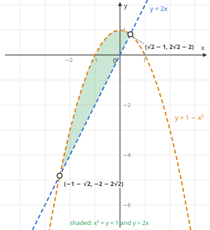

# System of inequalities

## Problem

Graph the system of inequalities. Label all points of intersection.

$$
\begin{cases}
x^2 + y < 1 \\
y > 2x
\end{cases}
$$

## My attempt

**What the problem asks.** Each inequality is a **region** of the plane, not a curve. The
answer is the region where both inequalities are true at the same time, drawn on a graph, with
the points where the two boundaries cross marked.

**Plan.** (a) find and identify the boundaries, (b) find where they cross, (c) decide dashed or
solid, (d) use a test point to pick the side of each boundary, (e) shade the overlap.

**Label the inequalities.**

$$
\begin{aligned}
x^2 + y &< 1 && (1) \\
y &> 2x && (2)
\end{aligned}
$$

### (a) Boundaries

Replace each inequality sign with $=$:

$$
\begin{aligned}
x^2 + y &= 1 \ \Rightarrow \ y = 1 - x^2 && (3) \\
y &= 2x && (4)
\end{aligned}
$$

**Identify (3) with the discriminant.** In the general form $x^2 + y - 1 = 0$: $A = 1$,
$B = 0$, $C = 0$.

$$
B^2 - 4AC = 0^2 - 4(1 \cdot 0) = 0 \ \Rightarrow \ \text{parabola}
$$

In $y = 1 - x^2$ the $x^2$ has coefficient $-1$, so it opens **down**, with vertex $(0, 1)$.

**(4)** is a line through the origin with slope $2$. A line and a parabola cross at most
twice.

### (b) Intersection points: substitute (4) into (3)

**Step 1: substitute $y = 2x$ into $x^2 + y = 1$ and complete the square.** To turn $-1$ into
$\left(\frac{2}{2}\right)^2 = 1$, add $\left(\frac{2}{2}\right)^2 + 1 = 2$ to both sides:

$$
\begin{aligned}
x^2 + 2x &= 1 \\[6pt]
x^2 + 2x - 1 &= 0 \\[6pt]
x^2 + 2x - 1 + 2 &= 0 + 2 \\[6pt]
x^2 + 2x + 1 &= 2 \\[6pt]
(x + 1)^2 &= 2 \\[6pt]
x + 1 &= \pm\sqrt{2} \\[6pt]
x &= -1 \pm \sqrt{2}
\end{aligned}
$$

**Step 2: find each $y$ with (3).**

$$
\begin{aligned}
x_1 = \sqrt{2} - 1: \quad (\sqrt{2} - 1)^2 + y &= 1 \\
2 - 2\sqrt{2} + 1 + y &= 1 \\
y &= 1 - 3 + 2\sqrt{2} = 2\sqrt{2} - 2 \\[10pt]
x_2 = -1 - \sqrt{2}: \quad (-1 - \sqrt{2})^2 + y &= 1 \\
2 + 2\sqrt{2} + 1 + y &= 1 \\
y &= 1 - 3 - 2\sqrt{2} = -2 - 2\sqrt{2}
\end{aligned}
$$

**Check with (4), $y = 2x$:**

| Point | $2x$ | $y$ | |
|---|---|---|---|
| $(\sqrt{2} - 1,\ 2\sqrt{2} - 2)$ | $2\sqrt{2} - 2$ | $2\sqrt{2} - 2$ | $\checkmark$ |
| $(-1 - \sqrt{2},\ -2 - 2\sqrt{2})$ | $-2 - 2\sqrt{2}$ | $-2 - 2\sqrt{2}$ | $\checkmark$ |

Approximately: $(0.41,\ 0.83)$ and $(-2.41,\ -4.83)$.

### (c) Dashed or solid

Both inequalities are strict ($<$ and $>$): points **on** the boundaries do not satisfy them.
Both boundaries are **dashed**, and the two intersection points are drawn as **open dots**:
they are labelled, but they are not part of the solution.

### (d) Test points: which side to shade

A boundary splits the plane into two sides. On one side the inequality is always true, on the
other always false. So testing **one** point tells you the whole side: plug a point that is not
on the boundary into the **original inequality**.

**(1) $x^2 + y < 1$.** Test $(0, 0)$, which is not on the parabola:

$$
0^2 + 0 < 1 \ \Rightarrow \ 0 < 1 \ \checkmark \ \text{true}
$$

Shade the side that contains the origin: **below** the parabola.

**(2) $y > 2x$.** The origin is **on** the line ($0 = 2 \cdot 0$), so it cannot decide the
side. Test $(0, 1)$ instead:

$$
1 > 2 \cdot 0 \ \Rightarrow \ 1 > 0 \ \checkmark \ \text{true}
$$

Shade the side that contains $(0, 1)$: **above** the line.

### (e) The overlap

The solution is the set of points that are below the parabola **and** above the line. Between
the two intersection points ($-1 - \sqrt{2} < x < \sqrt{2} - 1$) the parabola is above the
line, so there is a closed region between them. Outside that interval the parabola is below
the line, and no point can be both below one and above the other.

**Answer.** The solution is the region between the line $y = 2x$ (below) and the parabola
$y = 1 - x^2$ (above), with both boundaries dashed. The boundaries meet at
$(\sqrt{2} - 1,\ 2\sqrt{2} - 2)$ and $(-1 - \sqrt{2},\ -2 - 2\sqrt{2})$, which are not
included.

## Mistake / lesson

- **Test point on the boundary:** the origin is the easiest test point, but it fails when the
  boundary passes through it, as with $y = 2x$. Then pick another easy point, such as $(0, 1)$.
- **Shortcut for the partner value:** $y = 2x$ gives $y$ directly and is simpler than
  substituting back into the parabola. Using both is a free check.

## Related

- [Systems of nonlinear equations and inequalities](../../../notes/algebra/nonlinear-systems/two-variables.md)
